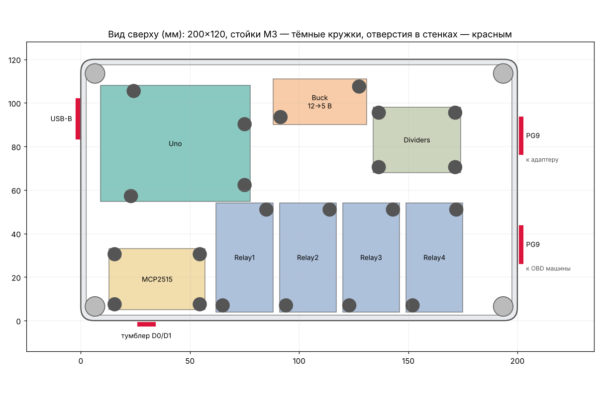

# Корпус переключателя OBD / obd_hub

Параметрическая модель FreeCAD: основание 200×120×72 + крышка 3 мм (всего 75 мм), стенки 2,5 мм,
крышка на 4 самореза M3 в угловых бобышках, бортик крышки входит в основание.

| Файл | Что это |
|---|---|
| `obd_switch_case.FCMacro` | макрос: все размеры в блоке «ПАРАМЕТРЫ» вверху |
| `obd_case.FCStd` | готовый документ (основание, крышка, модели плат) |
| `obd_case_base.step/.stl`, `obd_case_lid.step/.stl` | для слайсера; крышка уже перевёрнута для печати |

**Открыть:** FreeCAD → Макросы → Макросы… → указать папку с файлом → Выполнить. Или просто открыть
`obd_case.FCStd`. После правки параметров макрос перестраивает модель заново; чтобы он сам сохранил
STEP/STL, задайте `EXPORT_DIR = r"C:\путь\к\папке"`. Без окна: `freecadcmd obd_switch_case.FCMacro`.

**Внутри:** модели плат (Uno с шилдом HC-06, 4 реле JQC-3FF, MCP2515, LM2596, делители — для проверки компоновки, в STL не попадают) на стойках 6 мм под Uno (отверстия по чертежу Arduino), MCP2515, понижайку 12→5 В, плату
делителей и 4 модуля реле (по 26×50, стоят в ряд у передней стенки).
**В стенках:** окно под вилку USB-B Uno (левая), 2 гермоввода PG9 под кабели OBD (правая),
отверстие 6,2 мм под тумблер MTS-102 в разрыв D0/D1 к HC-06 (передняя), чтобы прошивать без снятия шилда.

**Перед печатью проверьте** штангенциркулем размеры и отверстия модулей реле, MCP2515, понижайки и
платы делителей (в макросе стоят типовые) и поправьте `BOARDS`. Положение USB-B рассчитано по чертежу Uno.

**Печать:** PETG или ASA (PLA в машине летом поведёт), стенки 3–4 периметра, заполнение 20–25 %,
без поддержек. Основание 200×120 влезает на стол 220×220 (Ender 3 и т.п.).
