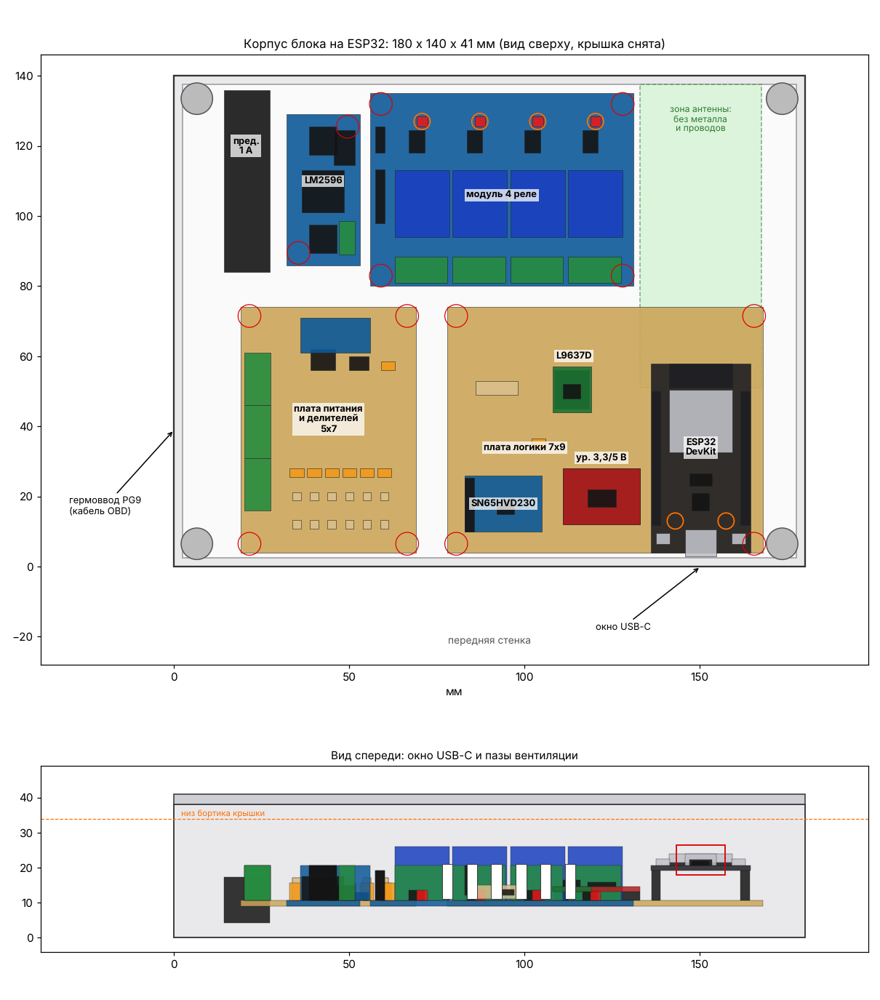

# Корпус блока на ESP32

Параметрическая модель FreeCAD для блока из [../README.md](../README.md): основание 180×140×38 +
крышка 3 мм (всего 41 мм), стенки 2,5 мм, крышка на 4 самореза M3 в угловых бобышках, бортик
крышки входит в основание. С ушками для крепления в машине основание 204×140 — влезает на стол
220×220.

| Файл | Что это |
|---|---|
| `esp32_block_case.FCMacro` | макрос: все размеры и положения плат в блоке «ПАРАМЕТРЫ» вверху |
| `esp32_block_case.FCStd` | готовый документ (основание, крышка, модели плат, зона антенны) |
| `esp32_case_base.step/.stl`, `esp32_case_lid.step/.stl` | для слайсера; крышка уже перевёрнута для печати |
| `layout.png` | вид сверху и спереди (макрос рисует его сам при запуске без окна) |

**Открыть:** FreeCAD → Макросы → Макросы… → указать папку с файлом → Выполнить, или открыть
`esp32_block_case.FCStd`. Без окна (пересобрать STEP/STL/FCStd/layout.png):
`freecadcmd esp32_block_case.FCMacro`. Макрос сам проверяет, что платы не задевают корпус и друг
друга, не упираются в бортик крышки и не заходят в зону антенны; замечания пишет в консоль
(«Компоновка: …»).

## Расположение и почему так

Две макетки вместо одной: на 7×9 всё не помещается, а силовую часть лучше держать отдельно.

| Где | Что | Почему |
|---|---|---|
| Спереди слева, у гермоввода | **Плата питания и делителей 5×7**: клеммники KF301 (9 проводов OBD: 16, 4, 5, 7, 8, 9, 11, 6, 14) у левого края, TVS, SS34, 100 мкФ (лёжа), 6 делителей | Кабель OBD сразу на клеммы, +12 В и масса сразу на защиту — грязные провода не идут через весь корпус |
| Сзади слева | **Предохранитель 5×20 в проводе** в ложементе с пазом под стяжку, рядом **LM2596** (поперёк) | Короткий путь: клемма 16 → предохранитель → защита → LM2596 → 5 В на плату логики |
| Сзади посередине | **Модуль 4 реле**, клеммы смотрят вперёд, входы IN слева | Провода 7/8/9/11 от клеммника и K_SEL к L9637D — короткие; винты клемм доступны сверху |
| Спереди справа | **Плата логики 7×9**: SN65HVD230 (ближе к клеммам CAN), преобразователь уровней 8 кан., L9637D на переходнике, 510 Ом 1 Вт, ESP32 в гнёздах | ESP32 снимается без пайки; USB-C упирается в окно передней стенки |
| Справа сзади | **Зона антенны** (зелёная в модели) | Перед антенной ESP32 до задней стенки нет металла: реле, LM2596 и провода — левее. Не кладите туда жгут |

L9637D в блоке одна (три в заказе — запас на случай перегрева при пайке).

## Отверстия

- **Левая стенка:** гермоввод **PG9** (отверстие 15,6 мм, кабель 4–8 мм) — под удлинитель OBD.
- **Передняя стенка:** окно 14×8,5 мм под штекер **USB-C** — прошивать и смотреть лог без
  вскрытия. Ряд из 6 пазов вентиляции внизу.
- **Задняя стенка:** 9 пазов вентиляции вверху (тёплый воздух выходит над реле). Вместе с передними
  получается сквозняк; греются в основном катушки реле (~0,35 Вт каждая включённая), LM2596 и ESP32.
- **Крышка:** 2 отверстия 3 мм над светодиодами ESP32 и 4 над светодиодами реле (видно, какая
  линия выбрана). Положение светодиодов типовое — сверьте со своими платами или задайте
  `LID_HOLES = []` и просверлите по месту.
- **Ушки** снизу слева и справа под саморез/винт M4 (отверстие 4,5 мм). Не нужны — `EARS = False`.

## Размеры — типовые, не измерены

| Модуль | В модели | Отверстия |
|---|---|---|
| ESP32 DevKit 30 pin, Type-C | 54×28,5, ряды выводов 25,4, на гнёздах 8,5 мм | нет (держится в гнёздах) |
| Макетки | 70×90 и 50×70 | Ø3 в 2,5 мм от краёв |
| Модуль 4 реле | 75×55, реле SRD-05VDC шагом 16,5 | Ø3 в 3 мм от углов |
| LM2596 | 43×21 | 2 по диагонали, 3,5 мм от краёв |
| SN65HVD230 | 22×16 | на штырях в макетке |
| Преобразователь уровней 8 кан. | 22×16 | на штырях в макетке |
| Держатель 5×20 в проводе | Ø13,5 × 52 | — |

**Перед печатью проверьте** штангенциркулем модуль реле, LM2596 и макетки (размер и отверстия) и
поправьте `RELAY4`, `LM2596`, `PERF_A/PERF_B`, `PERF_HOLES`, `BOARDS`. Если у ESP32 другая
распиновка или длина — `ESP_W`, `ESP_L`; окно USB-C пересчитается само.

## Печать и сборка

- PETG или ASA (PLA в машине летом поведёт). Металлизированный или углеродный пластик не берите —
  глушит Wi-Fi. 3–4 периметра, заполнение 20–25 %, без поддержек (окна небольшие).
- Платы — на саморезы 2,5–3 мм в стойки 6 мм; крышка — 4 самореза M3×12 с потайной головкой.
- LM2596 выставить на 5,0 В **до** установки в корпус (подстроечник окажется под проводами).
- Жгут от клеммника к реле и плате логики вести вдоль передней части; над ESP32 и в зелёной зоне
  проводов не оставлять.
